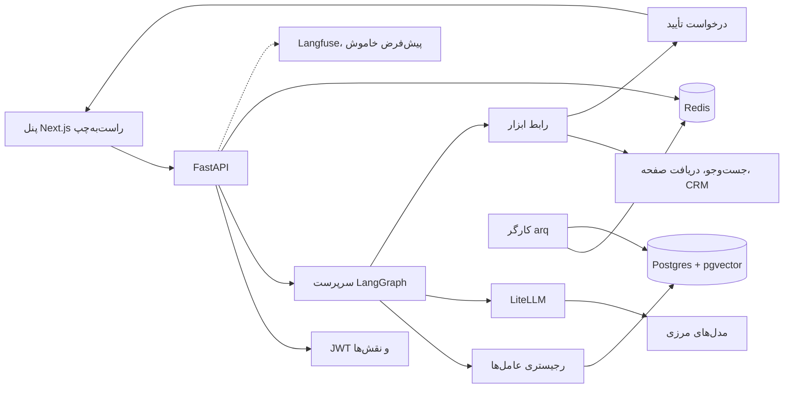

# ایرهاب

ایرهاب یک سامانهٔ وب برای کارشناسان خودِ شرکت است. عامل‌های هوشمند در تحقیق بازار، مشتری‌یابی، پشتیبانی مذاکرهٔ فروش، و مشاورهٔ طراحی و تجاری‌سازی به تولیدکنندگان کمک می‌کنند. تعداد عامل‌ها از پیش بسته نیست: هر عامل یک افزونه به‌علاوهٔ یک ردیف در پایگاه داده است و بعداً بدون تغییر گراف سرپرست اضافه می‌شود.

رابط کاربری فارسی و راست‌به‌چپ است. راهنمای انگلیسی در [README.md](README.md) است.

## معماری



- **مدل.** مدل آموزش داده نمی‌شود. [LiteLLM](https://docs.litellm.ai/) مدل‌های مرزی را صدا می‌زند و کلیدها از محیط می‌آیند (`GEMINI_API_KEY` و `ANTHROPIC_API_KEY` و `OPENAI_API_KEY`). هر عامل یک مدل **قوی** و یک مدل **سریع** دارد. اگر `MODEL_STRONG_DEFAULT` و `MODEL_FAST_DEFAULT` خالی باشند و فقط یک کلید تنظیم شده باشد، هر دو لایه از همان ارائه‌دهنده می‌آیند: جمینی `gemini/gemini-pro-latest` و `gemini/gemini-flash-latest`، انتروپیک `anthropic/claude-sonnet-4-5` و `anthropic/claude-haiku-4-5`، اوپن‌ای‌آی `openai/gpt-4o` و `openai/gpt-4o-mini`. شناسه‌های بازنشستهٔ جمینی ۲.۵ هنگام شروع عوض می‌شوند. اگر مدل قوی خطای ۴۲۹ یا ۵۰۳ بدهد، چند بار با فاصلهٔ کوتاه دوباره تلاش می‌شود و بعد مدل سریع و فهرست `MODEL_FALLBACKS` امتحان می‌شوند. مدلی که مدیر عوض کرده حفظ می‌شود. اگر `MOCK_LLM=auto` باشد و هیچ کلیدی نباشد، پاسخ فارسیِ مشخصاً آزمایشی برمی‌گردد تا پنل بدون کلید هم بالا بیاید.
- **هماهنگ‌کننده.** گراف LangGraph یک گرهٔ سرپرست و یک گرهٔ متخصص دارد. سرپرست `route_task` را صدا می‌زند و متخصص، عامل را از رجیستری و جدول `agents` می‌خواند. عامل جدید یعنی گرهٔ جدید نیست. `POST /api/tasks` همین گراف را اجرا می‌کند. گفتگوی پنل همان مسیریاب و همان اجراکننده را دارد و توکن‌ها را به‌صورت SSE می‌فرستد.
- **ابزارها.** متد `to_mcp_tool()` با شکل ابزار در پروتکل MCP جور است. `web_search` و `web_fetch` پشت یک ارائه‌دهندهٔ قابل تعویض‌اند و پیاده‌سازی فعلی ساختگی است. CRM یک جای‌نگهدار است. ابزارهای خروجی (`send_email` و `send_message` و `propose_price`) چیزی نمی‌فرستند؛ فقط درخواست تأیید می‌سازند.
- **تأیید انسان و قواعد.** کارشناس در پنل درخواست را تأیید یا رد می‌کند. بعد از تأیید، کارگر اقدام را اجرا می‌کند و امروز این اجرا فقط یک لاگ است. سقف تخفیف (`MAX_DISCOUNT_PERCENT`، پیش‌فرض ۱۵) در `app/rules/business.py` و پیش از ذخیرهٔ ردیف اعمال می‌شود. پرامپت نمی‌تواند این سقف را بالا ببرد.
- **کارهای پس‌زمینه.** [arq](https://github.com/python-arq/arq) روی Redis اقدام تأییدشده را اجرا می‌کند و می‌تواند سند را دوباره نمایه کند. اگر Redis در دسترس نباشد، اجرای تأیید داخل خود API انجام می‌شود تا دموی محلی تمام شود. برای گردش‌کارهای چندروزه، **Temporal** گزینهٔ بعدی است و در این اسکلت وصل نشده است.
- **مشاهده‌پذیری.** لاگ‌ها JSON هستند. با `LANGFUSE_ENABLED=true` و کلیدهای Langfuse، callback مربوط به LiteLLM فعال می‌شود. پیش‌فرض خاموش است.

## چه چیزهایی کار می‌کند

- `docker compose up` پستگرس (با pgvector)، ردیس، API، کارگر و پنل Next.js را بالا می‌آورد.
- Alembic اسکیما را می‌سازد. هنگام شروع، مدیر، چهار عامل نمونه، فهرست ابزارها و چند شرکت/سرنخ نمونه ساخته می‌شوند.
- ورود با JWT و نقش‌های `admin` و `expert` و `viewer`. مدیر عامل‌ها و کاربران را مدیریت می‌کند.
- کارشناس با یک عامل گفتگو می‌کند (پاسخ جریانی) یا کار را به سرپرست می‌سپارد. بیننده فقط می‌بیند.
- ساخت و ویرایش عامل از پنل در پستگرس ذخیره می‌شود و در نوبت بعدی به کار می‌رود.
- صف تأیید، سقف سخت تخفیف، و اجرای آزمایشی پس از تأیید.
- بارگذاری دانش، متن و بردار را ذخیره می‌کند. روی پستگرس جست‌وجو با فاصلهٔ کسینوسی pgvector است. ستون `vector(1536)` می‌ماند. بردار جمینی (`gemini/gemini-embedding-001` با خروجی ۷۶۸بعد) با صفر تا ۱۵۳۶ پر می‌شود و فاصلهٔ کسینوسی عوض نمی‌شود. بدون کلید، یا در حالت آزمایشی، بردار محلی و هم‌عرض ستون ساخته می‌شود.
- رخدادهای ورود، تغییر عامل و کاربر، تأییدها و بارگذاری در `audit_log` می‌نشیند.
- pytest برای رجیستری، قواعد تأیید و احراز API. گیت‌هاب اکشنز Ruff، pytest، لینت فرانت و ساخت فرانت را اجرا می‌کند.

## چه چیزهایی ساختگی است

- `web_search` و `web_fetch` تا وقتی `StubSearchProvider` و `StubFetchProvider` عوض نشده‌اند متن آماده برمی‌گردانند.
- جست‌وجوی CRM خالی و جای‌نگهدار است.
- ایمیل، پیام و پیشنهاد قیمت از فرایند خارج نمی‌شوند. کارگر فقط محمولهٔ تأییدشده را لاگ می‌کند.
- در حالت آزمایشی یک تشخیص سادهٔ کلیدواژه ممکن است ابزار را صدا بزند تا دمو نتیجهٔ جست‌وجو و صف تأیید را نشان دهد. در حالت واقعی فقط فراخوانی ابزارِ خودِ مدل اجرا می‌شود.
- سرپرست با جدول کلیدواژه مسیر می‌دهد. لایهٔ مدل سریع برای پاسخ عامل آماده است و هنوز طبقه‌بندِ سرپرست نیست.
- امبدینگ با کلید OpenAI از `text-embedding-3-small` و در غیر این صورت با کلید جمینی از `gemini/gemini-embedding-001` (خروجی ۷۶۸، پر شده تا ۱۵۳۶) می‌آید. حالت آزمایشی بردار محلی می‌سازد.
- SSO، ذخیره‌سازی فایل و مدیر راز تولید وجود ندارد.

## چیدمان

```
backend/app/agents/catalog/   هر عامل آماده یک ماژول با SPEC
backend/app/agents/registry.py
backend/app/agents/graph.py   گراف سرپرست
backend/app/tools/            ابزارها و ارائه‌دهنده‌ها
backend/app/rules/business.py قواعد تجاری داخل کد
backend/app/worker/           شغل‌های arq
frontend/app/                 صفحه‌های فارسی راست‌به‌چپ
```

## راه‌اندازی

مسیر پشتیبانی‌شده برای بالا آوردن همهٔ سرویس‌ها داکر است.

```bash
cp .env.example .env
make up
```

- پنل: http://localhost:3000
- مستندات API: http://localhost:8000/docs
- ورود توسعه: `admin@example.com` / `admin123`

پیش از آنکه ماشین در دسترس دیگران باشد `JWT_SECRET` و `ADMIN_PASSWORD` و گذرواژهٔ پایگاه داده را عوض کنید. مقدارهای `.env.example` فقط برای محیط محلی‌اند. فایل `.env` در گیت نمی‌آید.

فقط با جمینی (خط‌های مدل را خالی بگذارید تا هر دو لایه جمینی بمانند):

```bash
GEMINI_API_KEY=your-key
MOCK_LLM=auto
MODEL_STRONG_DEFAULT=
MODEL_FAST_DEFAULT=
MODEL_FALLBACKS=gemini/gemini-flash-latest,gemini/gemini-3.8-flash,gemini/gemini-3.5-flash
HTTPS_PROXY=http://host.docker.internal:10809
HTTP_PROXY=http://host.docker.internal:10809
NO_PROXY=postgres,redis,searxng,backend,frontend,worker,localhost,127.0.0.1
```

اگر در ایران ترافیک از v2rayN می‌گذرد، `HTTPS_PROXY` را همان `http://host.docker.internal:10809` بگذارید (پورت Mixed یا HTTP پروکسی v2rayN). کانتینر به پروکسی روی میزبان وصل می‌شود. `NO_PROXY` باید نام سرویس‌های کامپوز (postgres و redis و searxng و بقیه) را داشته باشد وگرنه خود پایگاه داده هم از پروکسی رد می‌شود. میزبان مدل زبانی را داخل `NO_PROXY` نگذارید: اگر اینترنت مستقیم قطع است، درخواست به جمینی یا `LLM_API_BASE` باید از همان پروکسی عبور کند. برای خود SearXNG متغیر `SEARXNG_PROXY` را بگذارید (اگر خالی باشد همان `HTTPS_PROXY` استفاده می‌شود)، مثلاً `SEARXNG_PROXY=http://host.docker.internal:10809`. بیلد تصویر، آرگومان‌های کوچک `http_proxy` و `https_proxy` را هم می‌گیرد چون apt فقط همان‌ها را می‌خواند. `GEMINI_API_BASE` نشانی اختصاصی جمینی است و `LLM_API_BASE` برای بقیهٔ مدل‌ها، به‌جز مدل‌هایی که با `openrouter/` شروع می‌شوند؛ آن‌ها به نشانی خود OpenRouter می‌روند. `OPENROUTER_API_KEY` فقط برای مدل جایگزین است، نه مدل اصلی. لایهٔ رایگان حدود ۵۰ درخواست مدل رایگان در روز است و خطای ۴۲۹ از سمت سرویس‌دهنده رایج است. نمونه: `MODEL_FALLBACKS=openai/gpt-4.1-mini,openrouter/nvidia/nemotron-3-ultra-550b-a55b:free,openrouter/nvidia/nemotron-3.5-super-vl:free`.

`ANTHROPIC_API_KEY` یا `OPENAI_API_KEY` هم به همین شکل کار می‌کنند. `MOCK_LLM=auto` با وجود هر کدام از این کلیدها حالت آزمایشی را خاموش می‌کند.

آزمون و لینت بدون داکر:

```bash
cd backend
python -m venv .venv && . .venv/bin/activate
pip install -r requirements.txt -r requirements-dev.txt
ruff check . && ruff format --check .
pytest
cd ../frontend && npm ci && npm run lint && npm run build
```

## نقش‌ها، کانال‌ها و خط زمان زنده

سه نقش وجود دارد: `admin` مدیرکل سیستم، `sales` کارشناس فروش، `supplier_acquisition` کارشناس جذب تأمین‌کننده. فروش عامل‌های مشتری‌یابی و مذاکره و سرنخ‌های مشتری را می‌بیند. جذب تأمین‌کننده عامل‌های تحقیق و مشاوره و سرنخ‌های تأمین‌کننده را می‌بیند. مدیر همهٔ کاربران، عامل‌ها و داده‌ها را می‌بیند.

ورودهای نمونه (پیش از دسترس دیگران عوضشان کنید):

- مدیر: `admin@example.com` / `admin123`
- فروش: `sales@example.com` / `sales12345`
- جذب تأمین‌کننده: `supplier@example.com` / `supplier12345`

صفحهٔ وظیفه با وب‌سوکت `/api/ws` به‌روز می‌شود. توکن در query یا ساب‌پروتکل `bearer.<jwt>` است. با `after_seq` رویدادهای جاافتاده دوباره پخش می‌شوند و کارگر از راه Redis آن‌ها را به API می‌رساند. توکن‌های مدل، هر ابزار، تعویض مدل و تأیید در همان خط زمان می‌آیند.

جست‌وجوی لینکدین و فیسبوک به‌طور پیش‌فرض از SearXNG و عملگر `site:` است و سرنخ را با `source=linkedin` یا `facebook` ذخیره می‌کند. `SOCIAL_PLAYWRIGHT_ENABLED` پیش‌فرض خاموش است. اگر روشن شود، کوکی حساب خودتان از `SOCIAL_SESSION_COOKIES` خوانده می‌شود. این کار با شرایط استفادهٔ لینکدین و متا در تعارض است و می‌تواند به مسدود شدن همان حساب منجر شود. هیچ رمزی در کد نیست.

ایمیل (SMTP و IMAP)، تلگرام، واتساپ و پیامک کاوه‌نگار کانال‌های جدا هستند. بدون کلید، وضعیت‌شان «تنظیم نشده» است و عامل آن‌ها را رد می‌کند. پیش‌فرض هر کانال «نیاز به تأیید» است؛ ارسال خودکار، سقف روزانه و انصراف را مدیر در صفحهٔ کانال‌ها تنظیم می‌کند. خود کلیدها از API برنمی‌گردند.

حافظهٔ بلندمدت در جدول `memories` است. `EMBEDDING_MODEL` پیش‌فرض `openai/text-embedding-3-small` است و از همان `LLM_API_BASE` و `OPENAI_API_KEY` گفتگو استفاده می‌کند. `EMBEDDING_DIM` پیش‌فرض ۱۵۳۶ است. اگر ساخت بردار خطا بدهد، جست‌وجو با متن کامل پستگرس (`tsvector`) ادامه پیدا می‌کند. صفحهٔ «حافظه» فهرست، جست‌وجو و حذف را دارد و هر نقش فقط حافظهٔ عامل‌های خودش را می‌بیند.

## اجرای خودمختار

هر عامل یک گراف LangGraph است: برنامه می‌ریزد، ابزار را صدا می‌زند، نتیجه را می‌بیند و تا تمام شدن هدف یا رسیدن به سقف گام تکرار می‌کند. وظیفه در کارگر arq اجرا می‌شود و با ری‌استارت از چک‌پوینت پستگرس ادامه پیدا می‌کند. از منوی «وظیفه‌ها» هدف را بنویسید، مثلاً:

> ۳۰ تولیدکننده مبلمان در تهران را با اطلاعات تماس پیدا کن، به‌عنوان سرنخ ثبت کن و رتبه‌بندی کن

پیشرفت (برنامه، هر ابزار، نتیجه و گزارش) زنده در همان صفحه می‌آید. ایمیل و پیشنهاد قیمت گراف را متوقف می‌کنند تا کارشناس در صف تأیید تصمیم بگیرد؛ بعد همان گراف از همان نقطه ادامه می‌دهد. جست‌وجوی وب از سرویس SearXNG داخل کامپوز است و پروکسی را رعایت می‌کند. اگر Docker Hub در ایران باز نشد، بیلد را با `DOCKER_BUILDKIT=0` و `--build-arg HTTPS_PROXY=http://host.docker.internal:10809 --build-arg https_proxy=http://host.docker.internal:10809` اجرا کنید. نصب pip و دانلود Chromium لایه‌های جدا هستند و شکست دانلود مرورگر بیلد را خراب نمی‌کند.

## افزودن عامل جدید

**از کد.** فایل `backend/app/agents/catalog/pricing_desk.py` را بسازید:

```python
from app.agents.registry import AgentSpec
from app.config import settings

strong, fast = settings.resolved_model_defaults()

SPEC = AgentSpec(
    slug="pricing_desk",
    name="Pricing Desk",
    name_fa="میز قیمت‌گذاری",
    description="کمک به قیمت‌گذاری داخلی.",
    system_prompt="تو میز قیمت‌گذاری هستی و به فارسی پاسخ می‌دهی.",
    allowed_tools=("knowledge_search", "propose_price"),
    model_strong=strong,
    model_fast=fast,
    temperature=0.2,
)
```

API را دوباره راه بیندازید. `load_package` هر ماژولی را که `SPEC` دارد ثبت می‌کند و seed اگر آن شناسه نباشد ردیف را می‌سازد. ویرایش بعدی در پنل حفظ می‌شود و seed آن را بازنویسی نمی‌کند. به گراف LangGraph گره اضافه نکنید.

**از پنل.** مدیر می‌تواند عامل را با شناسه، پرامپت، ابزارها و هر دو لایهٔ مدل بسازد. این عامل فقط در پایگاه داده است و از همان اجراکنندهٔ متخصص استفاده می‌کند. نام ابزار باید از قبل در رجیستری باشد.

## افزودن ابزار

1. از `Tool` در `backend/app/tools/builtin.py` (یا ماژول تازه) ارث ببرید و `execute` را بنویسید.
2. آن را در `register_builtin_tools` ثبت کنید.
3. اگر ابزار ایمیل، پیام یا پیشنهاد قیمت می‌فرستد، `request_approval` را صدا بزنید و `enforce_outbound_rules` را گسترش دهید. اثر جانبی را داخل خود ابزار انجام ندهید.
4. نام ابزار را در `allowed_tools` عامل بگذارید. اگر ابزار اثر خارجی دارد، آن را `kind = "outbound"` کنید تا گراف با `interrupt()` منتظر تأیید بماند و فقط بعد از تأیید اجرا شود.

ارائه‌دهنده را بدون دست زدن به عامل عوض کنید؛ مثلاً هنگام شروع `set_search_provider(my_provider)`.

## نقش‌ها

| نقش | اختیار |
| --- | --- |
| admin | همه‌چیز، از جمله عامل‌ها و کاربران |
| expert | گفتگو، بارگذاری دانش، ساخت و تصمیم تأیید |
| viewer | دیدن پنل |
