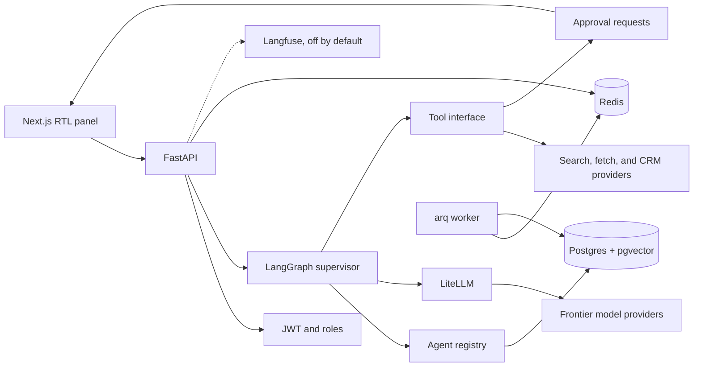

# IRHub

IRHub is a web platform for a company's own experts. Specialist AI agents help with market research, lead generation, sales negotiation, and design/commercialization consulting for manufacturers. The set of agents is open-ended: each agent is a plugin plus a database row, and more can be added without changing the supervisor graph.

The interface is Persian and right-to-left. This file is the English guide. The Persian guide is [README.fa.md](README.fa.md).

## Architecture



- **Models.** The product does not train a model. [LiteLLM](https://docs.litellm.ai/) calls frontier providers. Keys come from the environment (`GEMINI_API_KEY`, `ANTHROPIC_API_KEY`, `OPENAI_API_KEY`). Every agent stores a **strong** model and a **fast** model. Leave `MODEL_STRONG_DEFAULT` and `MODEL_FAST_DEFAULT` empty and a single configured key selects both tiers: Gemini uses `gemini/gemini-pro-latest` and `gemini/gemini-flash-latest`, Anthropic uses `anthropic/claude-sonnet-4-5` and `anthropic/claude-haiku-4-5`, OpenAI uses `openai/gpt-4o` and `openai/gpt-4o-mini`. Retired Gemini 2.5 ids are rewritten on startup. If the strong model returns 429 or 503, the call retries with backoff, then tries the fast model and `MODEL_FALLBACKS`. On startup, rows still marked as automatic defaults are updated. A model an admin edited is kept (`model_strong_is_default` / `model_fast_is_default` is false). If `MOCK_LLM=auto` and no key is set, the API returns a clearly marked Persian mock reply so the panel still runs.
- **Orchestration.** A LangGraph graph has one supervisor node and one specialist node. The supervisor calls `route_task`. The specialist loads whichever agent the registry and the `agents` table describe. Adding an agent does not add a graph node. `POST /api/tasks` runs that compiled graph. The chat stream uses the same router and the same specialist runner, and emits tokens as server-sent events.
- **Tools.** Tools implement one interface whose `to_mcp_tool()` shape matches an MCP `tools/list` item. `web_search` and `web_fetch` call a replaceable provider. The defaults are stubs. CRM lookup is a placeholder. Outbound tools (`send_email`, `send_message`, `propose_price`) do not send anything; they create an approval request.
- **Human approval and rules.** An expert approves or rejects the request in the panel. Only then does the worker run the action, and today that run is a log line. The discount cap (`MAX_DISCOUNT_PERCENT`, default 15) is enforced in `app/rules/business.py` before a row is stored. A prompt cannot raise the cap.
- **Jobs.** [arq](https://github.com/python-arq/arq) on Redis executes an approved action and can re-index a document. If Redis is down, approval execution falls back to the API process so local demos still finish. **Temporal** is the future option when approvals and negotiations become long-lived workflows. It is not wired up.
- **Observability.** Logs are JSON on stdout. Set `LANGFUSE_ENABLED=true` plus the Langfuse keys to attach LiteLLM's Langfuse callback. The hook is off by default.

## What works

- `docker compose up` starts Postgres (pgvector), Redis, the API, the worker, and the Next.js panel.
- Alembic creates the schema. Startup seeds an admin, the four example agents, the tool catalog, and sample companies/leads.
- JWT login with roles `admin`, `expert`, and `viewer`. Admins manage agents and users.
- Experts chat with an agent (streaming) or let the supervisor route a task. Viewers can read.
- Agent create/edit from the panel is stored in Postgres and used on the next turn.
- Approval queue, hard discount cap, and a stub execution after approval.
- Knowledge upload stores text and a vector. Search uses pgvector cosine distance on Postgres. The column stays `vector(1536)`. OpenAI embeddings are already that width. Gemini `gemini/gemini-embedding-001` is requested at 768 dimensions and zero-padded to 1536, which does not change cosine distance. With no key, or in mock mode, the vector is a deterministic local stub of the same width.
- Audit rows for login, agent and user changes, approvals, and uploads.
- Pytest for the registry, approval rules, and API auth. GitHub Actions runs Ruff, pytest, frontend lint, and the frontend build.

## What is stubbed

- `web_search` and `web_fetch` return canned text until you replace `StubSearchProvider` / `StubFetchProvider`.
- CRM lookup returns an empty placeholder.
- Email, message, and price-offer execution never leaves the process. The worker logs the approved payload.
- In mock mode a small keyword heuristic can call tools so the demo shows search results and approvals. Real mode follows the model's tool calls only.
- The supervisor routes with a keyword table. The fast model tier is available for agent replies; it is not yet a classifier.
- Embeddings call OpenAI `text-embedding-3-small` when that key is set, otherwise Gemini `gemini/gemini-embedding-001` at 768 dimensions, padded to 1536. Mock mode keeps the local stub.
- There is no SSO, object storage, or production secret manager.

## Project layout

```
backend/app/agents/catalog/   one module per built-in agent (exports SPEC)
backend/app/agents/registry.py
backend/app/agents/graph.py   supervisor graph
backend/app/tools/            MCP-shaped tools and providers
backend/app/rules/business.py hard-coded commercial rules
backend/app/worker/           arq jobs
frontend/app/                 Persian RTL pages
```

## Setup

Docker is the supported way to boot the stack.

```bash
cp .env.example .env
make up
```

- Panel: http://localhost:3000 (http://127.0.0.1:3000 is allowed by the default CORS list as well)
- API docs: http://localhost:8000/docs
- Development login: `admin@example.com` / `admin123`

Change `JWT_SECRET`, `ADMIN_PASSWORD`, and the database password before anyone else can reach the machine. The values in `.env.example` are local defaults, not production secrets. `.env` is gitignored.

Gemini-only setup (leave the model lines blank so both tiers stay on Gemini):

```bash
GEMINI_API_KEY=your-key
MOCK_LLM=auto
MODEL_STRONG_DEFAULT=
MODEL_FAST_DEFAULT=
MODEL_FALLBACKS=gemini/gemini-flash-latest,gemini/gemini-3.8-flash,gemini/gemini-3.5-flash
HTTPS_PROXY=http://host.docker.internal:10809
HTTP_PROXY=http://host.docker.internal:10809
NO_PROXY=postgres,redis,searxng,backend,frontend,worker,localhost,127.0.0.1
```

`HTTPS_PROXY` is optional. From inside Compose it must be a proxy on the host (`host.docker.internal` is mapped for this). `GEMINI_API_BASE` overrides the Gemini endpoint. `LLM_API_BASE` is the generic override and is not applied to `openrouter/` models, which keep LiteLLM's OpenRouter base. `OPENROUTER_API_KEY` is only for fallback models, not the primary tier. The free tier is about 50 free-model requests per day and upstream 429s are common. Example: `MODEL_FALLBACKS=openai/gpt-4.1-mini,openrouter/nvidia/nemotron-3-ultra-550b-a55b:free,openrouter/nvidia/nemotron-3.5-super-vl:free`.

`ANTHROPIC_API_KEY` or `OPENAI_API_KEY` work the same way. `MOCK_LLM=auto` turns mock mode off when any of those keys is set. Set `MOCK_LLM=false` to require a real call even if you want startup to fail without a key.

Tests and lint, without Docker:

```bash
cd backend
python -m venv .venv && . .venv/bin/activate
pip install -r requirements.txt -r requirements-dev.txt
ruff check . && ruff format --check .
pytest
cd ../frontend && npm ci && npm run lint && npm run build
```

## Autonomous runs

Each specialist is a LangGraph loop: plan, call tools, observe, and repeat until the goal is done or `max_steps` is reached. Tasks run in the arq worker. Checkpoints are stored in Postgres, so a restart or an approval pause can resume the same thread. The task page follows `/api/ws` (JWT in `?token=` or the `bearer.<jwt>` subprotocol) and replays missed events with `after_seq`. The worker fans events out through Redis. Model tokens, tool progress, retries, and fallback switches are on that timeline. Web search uses the bundled SearXNG service and honors `HTTPS_PROXY`. If Docker Hub is blocked, build with `DOCKER_BUILDKIT=0` and, when needed, `--build-arg HTTPS_PROXY=http://host.docker.internal:10809`.

`linkedin_search` and `facebook_search` use public `site:` queries. `SOCIAL_PLAYWRIGHT_ENABLED` is false by default. Turning it on reads the owner's cookies from `SOCIAL_SESSION_COOKIES` and can violate LinkedIn or Meta terms and get that account banned. Email, Telegram, WhatsApp, and Kavenegar SMS stay "not configured" until their env vars are set. Channel policy defaults to approval, with a daily cap and opt-out. The API never returns those secrets.

## How to add an agent

**From code.** Add `backend/app/agents/catalog/pricing_desk.py`:

```python
from app.agents.registry import AgentSpec
from app.config import settings

strong, fast = settings.resolved_model_defaults()

SPEC = AgentSpec(
    slug="pricing_desk",
    name="Pricing Desk",
    name_fa="میز قیمت‌گذاری",
    description="کمک به قیمت‌گذاری داخلی.",
    system_prompt="تو میز قیمت‌گذاری هستی و به فارسی پاسخ می‌دهی.",
    allowed_tools=("knowledge_search", "propose_price"),
    model_strong=strong,
    model_fast=fast,
    temperature=0.2,
)
```

Restart the API. `load_package` registers every module that exports `SPEC`, and the seed inserts a row when that slug is missing. Later edits in the panel are kept; the seed does not overwrite them. Do not add a node to the LangGraph graph.

**From the panel.** An admin can create an agent with a slug, prompt, tools, and both model tiers. It is stored only in the database and runs through the same specialist. Tool names must already exist in the tool registry.

## How to add a tool

1. Subclass `Tool` in `backend/app/tools/builtin.py` (or a new module) and implement `execute`.
2. Register it in `register_builtin_tools`.
3. If the tool can email, message, or offer a price, call `request_approval` and extend `enforce_outbound_rules`. Do not perform the side effect inside the tool.
4. Give the tool's name to an agent's `allowed_tools`.

Swap a provider without changing agents, for example `set_search_provider(my_provider)` during startup.

## Roles

| Role | Can |
| --- | --- |
| admin | Everything, including users, agents, channel policy, and all records |
| sales | Sales and lead-generation agents, customer leads, team conversations, approvals on their tasks |
| supplier_acquisition | Research and consulting agents, supplier leads, their conversations |

Demo logins: `admin@example.com` / `admin123`, `sales@example.com` / `sales12345`, `supplier@example.com` / `supplier12345`.
